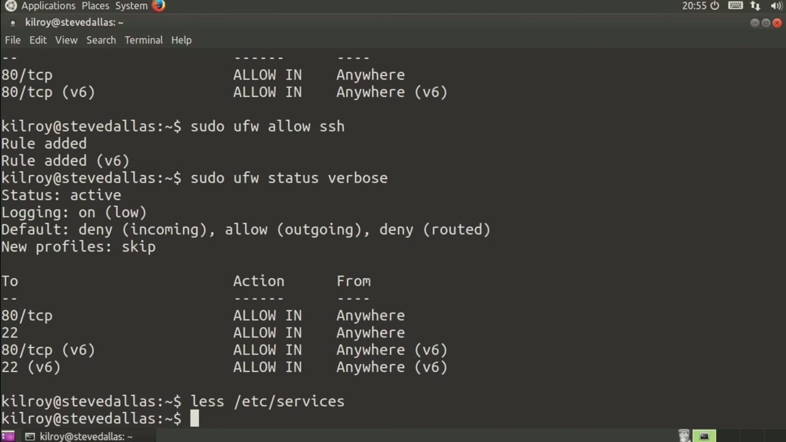
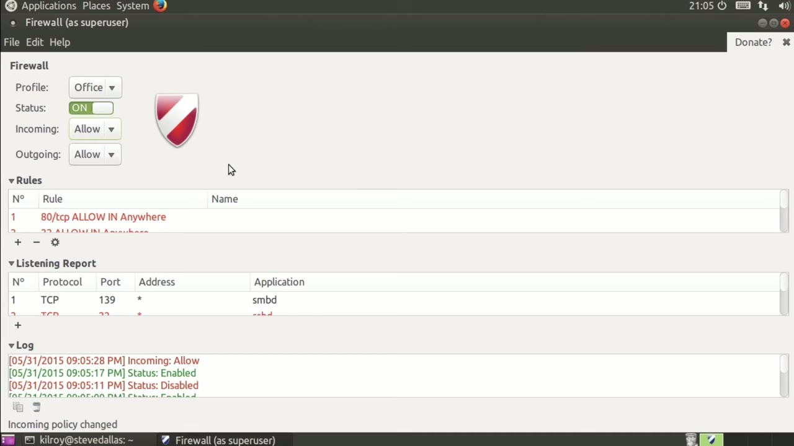
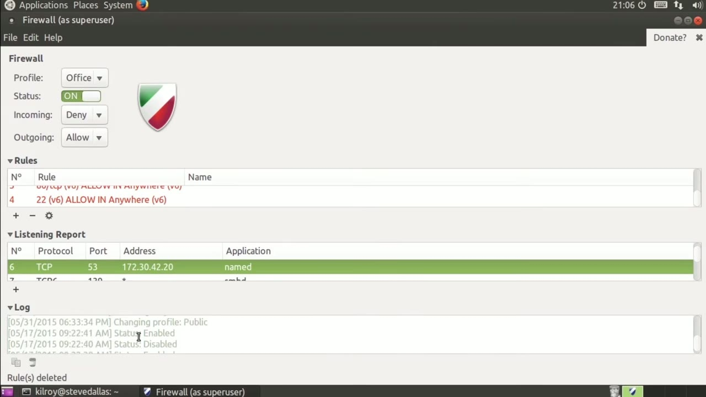

[← Course contents](../../02.md)

# 89. gufw

**Course:** [Linux Security & Administration From Boot Process to Firewalls](https://www.youtube.com/watch?v=_WB3evmgxYA)  
**Transcript:** [`Linux Security & Administration From Boot Process to Firewalls transcript`](../../../../course_videos/Linux%20Security%20%26%20Administration%20From%20Boot%20Process%20to%20Firewalls/Linux%20Security%20%26%20Administration%20From%20Boot%20Process%20to%20Firewalls.txt)  
**Video:** 06:06:24–06:08:36 ([open at this time](https://www.youtube.com/watch?v=_WB3evmgxYA&t=21984s))

## Introduction

You can do it with ufw really, really easily. Now we've done ufw with the command line. There actually is a graphical interface for it. You're not sweating too much. I can show you the graphical interface.

## Detailed Explanation

<details>
  <summary>Step 1 — Run `ufw`</summary>

### Step 1 — Run `ufw`

- [x] **Use `ufw`**
  - You can do it with `ufw` really, really easily.
  - Now we've done `ufw` with the command line.
  - There actually is a graphical interface for it.

- [x] **You're not sweating too much. I can show you the graphical interface**
  - You're not sweating too much. I can show you the graphical interface.
  - Here we've got a handful of different profiles.
  - All I have to do is click one side or the other, and it either turns it on or turns it off.

- [x] **Incoming, the default is going to be deny, and outgoing is going to**
  - Incoming, the default is going to be deny, and outgoing is going to be allow.

```bash
ufw
```



</details>

<details>
  <summary>Step 2 — I could set my default policy to be allow</summary>

### Step 2 — I could set my default policy to be allow

- [x] **So I could set my default policy to be allow**
  - So I could set my default policy to be allow.
  - Typically, you would want deny to be your incoming policy.
  - So here we've got the rules. These are the ones that we had set before, and I don't have an awful lot of screen real estate here.

- [x] **This top part takes up an awful lot. We do have three sections here**
  - This top part takes up an awful lot. We do have three sections here.
  - We've got listeners down here so you can look at the services that are actually listening.
  - And what I can do here is to create a rule based on one of these lines.

- [x] **So let's just pick NameD and then click Plus**
  - So let's just pick NameD and then click Plus.



</details>

<details>
  <summary>Step 3 — Run `gufw`, `ufw`</summary>

### Step 3 — Run `gufw`, `ufw`

- [x] **Now it's going to just automatically create a rule for me**
  - Now it's going to just automatically create a rule for me.
  - In order to add this rule so I could specify, allow, deny, reject, or limit.
  - So now we've got the rule in up top here.

- [x] **Use `gufw`, `ufw`**
  - If I want to get rid of the rule, all I have to do is click the -rule is now gone.
  - `gufw`, very, very simple user interface that will allow you to manage your `ufw` rules.
  - You can take a look at all of your listeners.

- [x] **Use `ufw`**
  - And then, of course, we've got the status log here in terms of what you are doing.
  - So you can see the actual `ufw` commands that are being executed when we make changes using this graphical user interface.

```bash
gufw
ufw
```



</details>

<details>
  <summary>Questions and Answers</summary>

## Questions and Answers

### Question 1: What does `ufw` do in this chapter?

<details>
<summary>Answer</summary>

- [x] You can do it with `ufw` really, really easily.

</details>

### Question 2: What does `gufw` do in this chapter?

<details>
<summary>Answer</summary>

- [x] `gufw`, very, very simple user interface that will allow you to manage your ufw rules.

</details>

### Question 3: What does step 1 cover (Run ufw)?

<details>
<summary>Answer</summary>

- [x] You can do it with `ufw` really, really easily.
- [x] Now we've done `ufw` with the command line.
- [x] There actually is a graphical interface for it.

</details>

### Question 4: What does step 2 cover (I could set my default policy to be allow)?

<details>
<summary>Answer</summary>

- [x] So I could set my default policy to be allow.
- [x] Typically, you would want deny to be your incoming policy.
- [x] So here we've got the rules. These are the ones that we had set before, and I don't have an awful lot of screen real estate here.

</details>

### Question 5: What does step 3 cover (Run gufw, ufw)?

<details>
<summary>Answer</summary>

- [x] Now it's going to just automatically create a rule for me.
- [x] In order to add this rule so I could specify, allow, deny, reject, or limit.
- [x] So now we've got the rule in up top here.

</details>

</details>

## Summary

This chapter, gufw, walks through Run ufw; I could set my default policy to be allow; Run gufw, ufw. Commands from the transcript: `ufw`, `gufw`.

## References

- [Linux Security & Administration From Boot Process to Firewalls (YouTube)](https://www.youtube.com/watch?v=_WB3evmgxYA)
- [This chapter at 06:06:24](https://www.youtube.com/watch?v=_WB3evmgxYA&t=21984s)
- [Local transcript](../../../../course_videos/Linux%20Security%20%26%20Administration%20From%20Boot%20Process%20to%20Firewalls/Linux%20Security%20%26%20Administration%20From%20Boot%20Process%20to%20Firewalls.txt)
