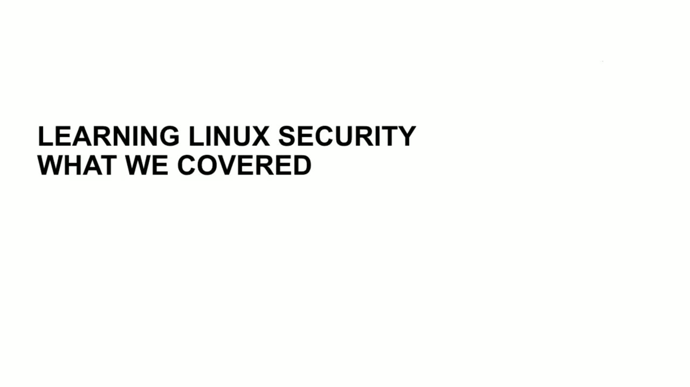
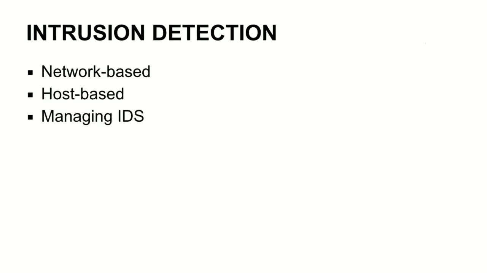
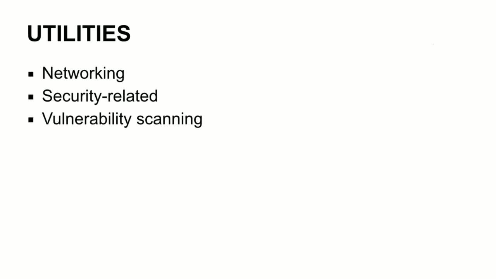
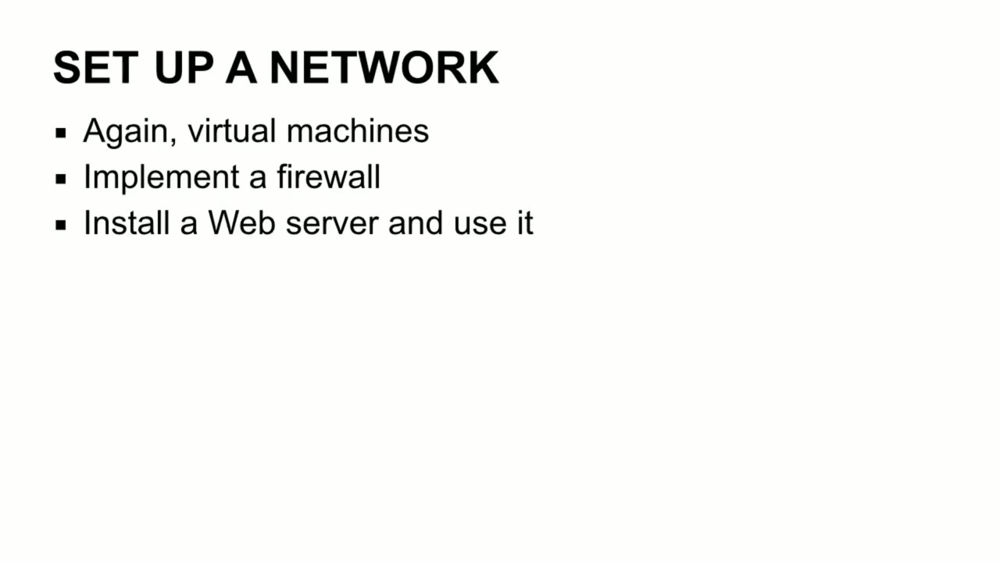

[← Course contents](../../02.md)

# 90. Course Summary & Conclusion

**Course:** [Linux Security & Administration From Boot Process to Firewalls](https://www.youtube.com/watch?v=_WB3evmgxYA)  
**Transcript:** [`Linux Security & Administration From Boot Process to Firewalls transcript`](../../../../course_videos/Linux%20Security%20%26%20Administration%20From%20Boot%20Process%20to%20Firewalls/Linux%20Security%20%26%20Administration%20From%20Boot%20Process%20to%20Firewalls.txt)  
**Video:** 06:08:36–06:14:09 ([open at this time](https://www.youtube.com/watch?v=_WB3evmgxYA&t=22116s))

## Introduction

Well, let's wrap up. What did we cover? Well, we covered a fair amount of ground, I think. We covered what a distribution is, the different distributions that are available. We made use of a couple of different distributions. We looked at Centos, which is binary identical to Red Hat Enterprise Linux. And we looked at Ubuntu as well as taking a look at a specialized distribution of Linux called Kali Linux.

## Detailed Explanation

<details>
  <summary>Step 1 — Run `snort`</summary>

### Step 1 — Run `snort`

- [x] **Well, let's wrap up. What did we cover? Well, we covered a fair**
  - Well, let's wrap up. What did we cover? Well, we covered a fair amount of ground, I think.
  - We covered what a distribution is, the different distributions that are available.
  - We made use of a couple of different distributions. We looked at Centos, which is binary identical to Red Hat Enterprise Linux.

- [x] **And we looked at Ubuntu as well as taking a look at a specialized**
  - And we looked at Ubuntu as well as taking a look at a specialized distribution of Linux called Kali Linux.
  - We looked at the boot process, the two boot loaders, GRUB and LILO, as well as protecting the boot process and how you can edit boot menus.
  - We looked at services, the different types of services you might see on a system.

- [x] **Like Apache or a Java application server**
  - Like Apache or a Java application server.
  - We also looked at PostFix and how to make use of gray listing to keep spam away from your mail service.
  - We looked at hardening the various services and the different configuration changes you might make to make your services more robust and protect them against the tag.

- [x] **Use `snort`**
  - We looked at logging, syslog, log management, remote logging, so sending logs off to remote systems, so that you've got an extra copy somewhere in case something happens to the system where the log was generated.
  - We talked about intrusion detection, we talked about network-based like `snort`, we talked about host-based, like using Samhain or Aid.
  - And we also talked about using other utilities like Prelude, for example, to manage your IDS's and have some consoles available so that you can actually see the different alerts and messages you're getting from your intrusion detection systems.

- [x] **We talked about App, Armour, and SELinux, which are both**
  - We talked about App, Armour, and SELinux, which are both implementations of mandatory access controls.
  - Talked about adding users, setting password policies, and using the Pluggable Authentication Modules, which is also known as Pam.

```bash
snort
```





</details>

<details>
  <summary>Step 2 — Run `nmap`, `iptables`, `ufw`</summary>

### Step 2 — Run `nmap`, `iptables`, `ufw`

- [x] **Use `nmap`, `iptables`, `ufw`**
  - Looked at different utilities, networking. So we looked at `nmap`, for example.
  - We looked at security-related tools. We looked at vulnerability scanning.
  - We also took a look at the Linux kernel. So the kernel source, we looked at modules, configuring the kernel, building the kernel. Then we looked at firewalls. We took a look at `iptables`, firewalld, and then the uncomplicated firewall, which is called `ufw`.

- [x] **So we did cover a fair amount of ground here. It's an awful lot to**
  - So we did cover a fair amount of ground here. It's an awful lot to digest. So in the next lesson we'll be talking about what you can do next. So what comes next? Well, I would really recommend doing a lot of hands-on work.
  - Centos.org will give you a free distribution of Centos.
  - Centos is binary compatible with Red Hat Enterprise Linux, so it's just like you're using Red Hat Enterprise Linux without paying for it.

- [x] **Ubuntu.com will give you distributions of Ubuntu, of course**
  - Ubuntu.com will give you distributions of Ubuntu, of course.
  - If you're looking for something else, you can go to distrowatch.com.
  - There are a large number of Linux distributions that are available if you feel like playing.

- [x] **I happen to be looking at one here that's apparently based on Ubuntu**
  - I happen to be looking at one here that's apparently based on Ubuntu called Peppermint OS.
  - Sounds like it might be a little bit of fun to play with.
  - If you need systems, get virtual machines, VMware Player is free, Virtual Box is free.

- [x] **This is virtualization software that will allow you to run Linux**
  - This is virtualization software that will allow you to run Linux inside of Windows.
  - If you've got a Mac, you can use parallels. Virtual Box will also run on a Mac.

```bash
nmap
iptables
ufw
```



</details>

<details>
  <summary>Step 3 — Run `at`, `snort`</summary>

### Step 3 — Run `at`, `snort`

- [x] **Use `at`**
  - Mostly play, play, play, play, play. Just get in and start working with the utilities and the tools and things that we've talked about.
  - You can certainly set up a network. You can do this inside of virtual machines.
  - You can have multiple virtual machines running `at` once. I will recommend you get an awful lot of memory if you want to run multiple virtual machines.

- [x] **Implement yourself a firewall with Linux**
  - Implement yourself a firewall with Linux.
  - Do some of the things that we've been talking about.
  - I can't stress enough getting your hands dirty and just playing with it.

- [x] **Use `snort`**
  - As I said, hands on, hands on, hands on.
  - With some versions of Linux, you can actually boot directly to a live running instance of it without even having to do an installation.
  - So try some of those, but really hands-on work, install Linux and start making use of it and start installing things like `snort` and trying to throw attacks `at` it so that you can see the various alerts that it will show. So again, I mean, I'm going to say it again and I've said it several

- [x] **That's the best way to really get a handle on what all of this looks**
  - That's the best way to really get a handle on what all of this looks like and how you can best make use of it.
  - So just to wrap up, really want to thank you for taking the time to watch these videos.
  - It has been my pleasure to walk through the different aspects of Linux security in order to help you better understand it and get to the point where you can actually make use of and implement some of these things for yourself in your personal life, in your work life.

- [x] **Wherever it is, you end up using this knowledge and information**
  - Wherever it is, you end up using this knowledge and information.

```bash
at
snort
```



</details>

<details>
  <summary>Questions and Answers</summary>

## Questions and Answers

### Question 1: What does `snort` do in this chapter?

<details>
<summary>Answer</summary>

- [x] We talked about intrusion detection, we talked about network-based like `snort`, we talked about host-based, like using Samhain or Aid.

</details>

### Question 2: What does `nmap` do in this chapter?

<details>
<summary>Answer</summary>

- [x] Looked at different utilities, networking. So we looked at `nmap`, for example.

</details>

### Question 3: What does `iptables` do in this chapter?

<details>
<summary>Answer</summary>

- [x] We also took a look at the Linux kernel. So the kernel source, we looked at modules, configuring the kernel, building the kernel. Then we looked at firewalls. We took a look at `iptables`, firewalld, and then the uncomplicated firewall, which is called ufw.

</details>

### Question 4: What does `ufw` do in this chapter?

<details>
<summary>Answer</summary>

- [x] We also took a look at the Linux kernel. So the kernel source, we looked at modules, configuring the kernel, building the kernel. Then we looked at firewalls. We took a look at iptables, firewalld, and then the uncomplicated firewall, which is called `ufw`.

</details>

### Question 5: What does `at` do in this chapter?

<details>
<summary>Answer</summary>

- [x] You can have multiple virtual machines running `at` once. I will recommend you get an awful lot of memory if you want to run multiple virtual machines.

</details>

### Question 6: What does step 1 cover (Run snort)?

<details>
<summary>Answer</summary>

- [x] Well, let's wrap up. What did we cover? Well, we covered a fair amount of ground, I think.
- [x] We covered what a distribution is, the different distributions that are available.
- [x] We made use of a couple of different distributions. We looked at Centos, which is binary identical to Red Hat Enterprise Linux.

</details>

### Question 7: What does step 2 cover (Run nmap, iptables, ufw)?

<details>
<summary>Answer</summary>

- [x] Looked at different utilities, networking. So we looked at `nmap`, for example.
- [x] We looked at security-related tools. We looked at vulnerability scanning.
- [x] We also took a look at the Linux kernel. So the kernel source, we looked at modules, configuring the kernel, building the kernel. Then we looked at firewalls. We took a look at `iptables`, firewalld, and then the uncomplicated firewall, which is called `ufw`.

</details>

### Question 8: What does step 3 cover (Run at, snort)?

<details>
<summary>Answer</summary>

- [x] Mostly play, play, play, play, play. Just get in and start working with the utilities and the tools and things that we've talked about.
- [x] You can certainly set up a network. You can do this inside of virtual machines.
- [x] You can have multiple virtual machines running `at` once. I will recommend you get an awful lot of memory if you want to run multiple virtual machines.

</details>

</details>

## Summary

This chapter, Course Summary & Conclusion, walks through Run snort; Run nmap, iptables, ufw; Run at, snort. Commands from the transcript: `snort`, `nmap`, `iptables`, `ufw`, `at`.

## References

- [Linux Security & Administration From Boot Process to Firewalls (YouTube)](https://www.youtube.com/watch?v=_WB3evmgxYA)
- [This chapter at 06:08:36](https://www.youtube.com/watch?v=_WB3evmgxYA&t=22116s)
- [Local transcript](../../../../course_videos/Linux%20Security%20%26%20Administration%20From%20Boot%20Process%20to%20Firewalls/Linux%20Security%20%26%20Administration%20From%20Boot%20Process%20to%20Firewalls.txt)
